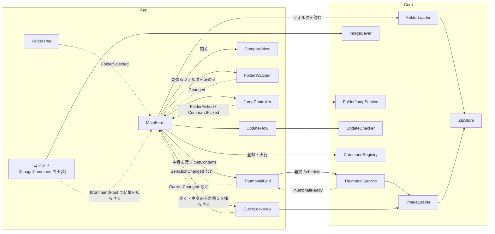
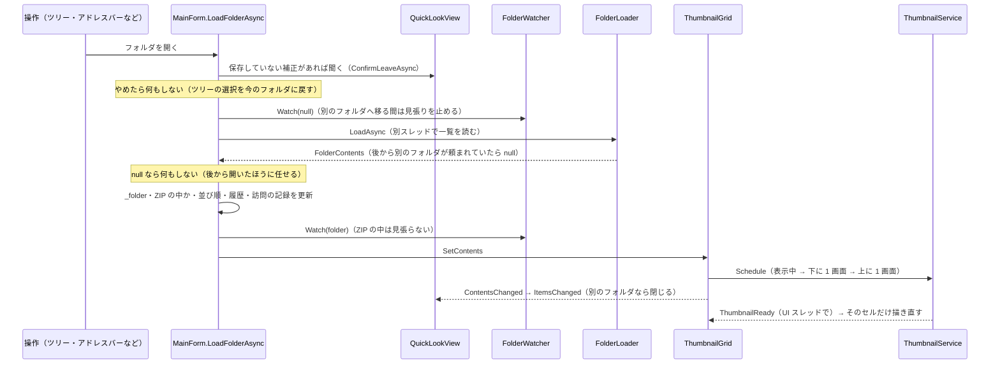

# 設計資料

コードを変える前に、影響の範囲を判断するための資料。読み手は人の開発者と AI の両方。

- 実装の細部は書かない（変わるのが速いので、コードを読めば分かることはコードに任せる）。**守らないと壊れる約束事**と、**変更の種類ごとにまず読む場所**を書く
- リンクは行番号ではなく、ファイルと型に張る。メソッドは名前で書くので、ファイルの中を名前で検索する
- 起動・コマンドの追加例・保存データ・リリースの手順は [development.md](development.md)、人の手で確かめる項目は [manual-test.md](manual-test.md)

## 全体の構成

| プロジェクト | 役割 | 依存 |
|---|---|---|
| [`ImageViewer.Core`](../src/ImageViewer.Core) | UI に依存しない中核。画像の読み書き（SkiaSharp・WIC）、編集処理、フォルダの一覧、サムネイルの生成、設定の保存 | WinForms の画面部品は使わない（サムネイルを GDI+ の `Bitmap` で持つために `System.Drawing` だけ使う） |
| [`ImageViewer.App`](../src/ImageViewer.App) | WinForms の画面。一覧・1 枚表示・メニュー・ダイアログ・コマンドの実装 | Core |
| [`ImageViewer.Tests`](../tests/ImageViewer.Tests) | 動作テスト（Core と、画面を出さずに動かせる App の部品） | Core・App |

依存は App → Core の一方向。Core に画面の処理を入れない（テストで動かせなくなる）。

### 主なクラスの関係

実線は呼び出し、点線はイベント・コールバックで知らせる向き。部品どうしは直接つながず、**MainForm が仲立ちする**（例: 1 枚表示で画像を送ると `QuickLookView.CurrentChanged` → MainForm → `ThumbnailGrid.SelectImage`）。

## 主なクラスの責務

| クラス | 持つもの・すること | しないこと |
|---|---|---|
| [`MainForm`](../src/ImageViewer.App/MainForm.cs) | 開いているフォルダ（`_folder`・`_inArchive`）、並び順、戻る / 進むの履歴、名前の変更の「元に戻す」、設定（`AppSettings`）。部品の組み立てとイベントの配線、メニュー、コマンドの実行と結果の反映（`ICommandHost`・`ISettingsAccess` の実装） | 画像の読み込み・サムネイル・検索の中身（それぞれの持ち主に任せる） |
| [`FolderLoader`](../src/ImageViewer.Core/Navigation/FolderLoader.cs) | フォルダ（ZIP の中も）の一覧を別スレッドで読み、並び順を当てる。続けて頼まれたら最後の結果だけを返す | 画面の更新（結果を返すだけ） |
| [`FolderWatcher`](../src/ImageViewer.App/Filer/FolderWatcher.cs) | 開いているフォルダの外での変化を見張り、落ち着いてから `Changed` を 1 回出す（UI スレッドで） | 読み直し（MainForm が `LoadFolderAsync` を reload で呼ぶ） |
| [`ThumbnailGrid`](../src/ImageViewer.App/Grid/ThumbnailGrid.cs) | 一覧の表示・選択・チェック・ドラッグ（並べ替え・外へのドラッグ・ドロップ）・名前の入力。見えている分のサムネイルを要求する | ファイルの書き換え（ドロップや名前の変更は MainForm へイベントで渡す） |
| [`ThumbnailService`](../src/ImageViewer.Core/Thumbnails/ThumbnailService.cs) | サムネイルの待ち行列・生成スレッド・メモリ上のキャッシュ（上限 128MB） | 何を要求するかの判断（ThumbnailGrid が決める） |
| [`QuickLookView`](../src/ImageViewer.App/Viewer/QuickLookView.cs) | 1 枚表示。今の画像と前後 1 枚の先読み、100% 表示、アニメ、色調補正（保存していない補正を含む） | 一覧の選択の変更（`CurrentChanged` で頼む） |
| [`CompareView`](../src/ImageViewer.App/Viewer/CompareView.cs) | 2 枚並べて比べる | 同上 |
| [`JumpController`](../src/ImageViewer.App/Jump/JumpController.cs) | フォルダジャンプ（アドレスバーの候補・フォルダの索引・訪問の記録・Everything との連携） | フォルダを開く・コマンドを実行する（`FolderPicked` / `CommandPicked` で MainForm に任せる） |
| [`UpdateFlow`](../src/ImageViewer.App/UpdateFlow.cs) | 起動時の更新の確認、見つけた版、更新のダイアログ、新しい exe での起動し直し | 確認の通信の中身（[`UpdateChecker`](../src/ImageViewer.Core/Updates/UpdateChecker.cs)）と exe の入れ替え（[`SelfUpdate`](../src/ImageViewer.Core/Updates/SelfUpdate.cs)） |
| [`CommandRegistry`](../src/ImageViewer.Core/Commands/CommandRegistry.cs) / [`IImageCommand`](../src/ImageViewer.Core/Commands/IImageCommand.cs) | 登録したコマンドから ☰・右クリック・ショートカット・コマンド検索を組み立てる | — |
| [`ZipStore`](../src/ImageViewer.Core/Archives/ZipStore.cs) | ZIP の目次と中のファイルの読み出し（展開せずに読む。書き換えない） | — |

## フォルダを開く流れ

ツリー・アドレスバー・フォルダジャンプ・戻る / 進む・ドロップ・外での変化は、どれも `MainForm.LoadFolderAsync` に集まる。

### 打ち切りと、古い結果を捨てる条件

非同期の処理は、どれも「**後から頼まれたものが勝つ**」。前の処理の結果は、読めていても失敗していても画面に出さない。

| 処理 | 新しい依頼が来たとき | 古い結果の見分け方 |
|---|---|---|
| フォルダの一覧（`FolderLoader.LoadAsync`） | 前の `CancellationTokenSource` を打ち切る | 自分の `CancellationTokenSource` が最新でなければ null を返す。古い読み込みの例外も握りつぶす（エラーを出さない） |
| サムネイル（`ThumbnailService.Schedule`） | 待ち行列を丸ごと差し替える（スクロールで外れた要求は消える） | 大きさを変えると `_generation` が増え、生成中だった古い大きさの結果は Dispose して捨てる |
| 1 枚表示の先読み（`QuickLookView.LoadAroundAsync`） | `_loadCts` を打ち切る。前後 1 枚の範囲から外れたものはキャッシュから捨てる | 打ち切られた・閉じた・ほかの読み込みが先に入れた結果は Dispose |
| 100% の原寸・アニメのコマ（`LoadFullAsync`・`LoadAnimationAsync`） | それぞれ `_fullCts`・`_animCts` を打ち切る | 次の画像へ移った・閉じた後に届いた結果は Dispose |
| フォルダジャンプの候補（`JumpController.UpdateListAsync`） | `_cts` を打ち切る | 打ち切られた、またはアドレスバーからフォーカスが外れていたら出さない |
| 選択中の画像の詳細（`MainForm.UpdateSelectionInfoAsync`） | `_infoCts` を打ち切る（選択を素早く変えている間は 100ms 待ってから読む） | 同上 |
| 外での変化（`FolderWatcher`） | 最後の変化から 400ms 静かになるまで待つ（続いていても 2 秒で一度知らせる）。マウスのボタンを押している間（ドラッグ中）は待つ | 知らせたときに開いているフォルダが違えば、MainForm が無視する |

ほかに守っていること:

- **別のフォルダへ移る前に、保存していない補正を確かめる。** 1 枚表示は移ると閉じるので、先に `ConfirmUnsavedAdjustAsync` で聞く。ウィンドウを閉じるとき（`FormClosing`）も同じ
- **移る間は見張りを止める。** 前のフォルダの変化で読み直しが始まると、移る途中の読み込みが打ち切られる
- **読み直し（reload）では選択・チェック・スクロール位置を引き継ぐ**（`ThumbnailGrid.SetContents` の `reload`）。別のフォルダへ移ったときは引き継がない
- **コマンドの結果を待つ間に別のフォルダへ移っていたら、反映しない。** `FilesAddedAsync` は通知されたフォルダが今のフォルダと違えば何もしない

## スレッド: UI スレッドだけで触る状態

WinForms のコントロールと次の状態は、**UI スレッドだけ**で読み書きする。別スレッドで作った結果は UI スレッドへ戻してから反映する（`await` の続き、`SynchronizationContext.Post`、`FileSystemWatcher.SynchronizingObject`）。

- MainForm のフィールドすべて（開いているフォルダ・設定・履歴・元に戻す など）
- `ThumbnailService` のキャッシュ（`_cache`・`_lru`・`_failed`）。生成スレッドと共有するのは待ち行列だけで、`_lock` で守る。出来たサムネイルは `Post` で UI スレッドに渡してからキャッシュに入れる
- `ThumbnailGrid` の項目・選択・チェック
- `QuickLookView` / `CompareView` の画像のキャッシュと、表示中の番号

別スレッドで動かすのは、フォルダの一覧（`Task.Run`）・サムネイルの生成（STA のワーカースレッド。シェルの COM を使うため）・画像の読み込みと保存・検索・更新の確認。別スレッドの処理から MainForm やコントロールに触らない。

## Bitmap の持ち主と Dispose

GDI+ の `Bitmap` は、作った側が 1 人の持ち主を決めて、その持ち主だけが Dispose する。借りた `Bitmap` を保持したり Dispose したりしない。

| Bitmap | 持ち主 | Dispose するとき | 借りる側の約束 |
|---|---|---|---|
| 一覧のサムネイル | `ThumbnailService` | 上限を超えて古いものを捨てるとき、大きさを変えたとき、終了時 | `TryGet` で受け取ったものは、その描画の間だけ使う（次の描画までに捨てられることがある）。1 枚表示・比較の仮表示（`PlaceholderProvider`）も同じ |
| 1 枚表示の画像（今の画像と前後 1 枚） | `QuickLookView._cache` | 前後 1 枚の範囲から外れたとき、書き換えられた画像を読み直すとき、閉じるとき | — |
| 1 枚表示の原寸（100%）・アニメのコマ・補正をかけた表示 | `QuickLookView` | 次の画像へ移る、閉じる、補正を変える・やめるとき | — |
| 2 枚比較の画像 | `CompareView` | 替えたとき・閉じたとき | — |
| フォルダ・ZIP のタイルのアイコン | `ThumbnailGrid` | 大きさを変えたとき・Dispose | — |
| 編集処理の画像（`SKBitmap`） | 読み込んだ処理（`ImageLoader.Load` の呼び出し側） | 使い終わったら `using` で | 編集の API は `SKBitmap` で受け渡し、表示用の GDI+ の `Bitmap` には `ThumbnailGenerator.ToPArgbBitmap` で変える |

別スレッドで作ったが使われなかった `Bitmap`（打ち切られた・古い大きさ・閉じた後に届いた）は、受け取った側がその場で Dispose する。

## 保存とファイル操作の約束

- **書き込みは一時ファイルに書き切ってから差し替える。** 画像は [`ImageSaver`](../src/ImageViewer.Core/Editing/ImageSaver.cs)（一時ファイルは `元の名前.32 桁の英数字.tmp`）、設定などは [`AtomicFile`](../src/ImageViewer.Core/Settings/AtomicFile.cs)。途中で落ちても、元のファイルか新しいファイルのどちらかが完全に残る
- **元の画像を置き換える前に [`SourceGuard`](../src/ImageViewer.Core/Editing/SourceGuard.cs) で確かめる。** 書き出せない形式、アニメ・複数ページ（先頭のコマだけになる）、撮影情報を残せない形式は置き換えない
- **一時ファイルの名前を変えたら、[`FolderWatcher.Relevant`](../src/ImageViewer.App/Filer/FolderWatcher.cs) も合わせる。** 保存・名前の変更の途中の一時ファイルで読み直さないよう、名前で見分けている（[`RenameExecutor`](../src/ImageViewer.Core/Rename/RenameExecutor.cs) の `~ivren_….tmp` も同じ）
- **コマンドは結果を `ICommandHost` で知らせる。** 一覧を自分で書き換えない
  - ファイルを足した → `FilesAddedAsync`（読み直して、足したものを選ぶ）
  - 消した・ほかのフォルダへ移した → `FilesRemoved`（一覧から外し、消えた位置の次を選ぶ。1 枚表示なら次の画像を出す）
  - 名前を変えた → `FilesRenamed`（チェック・選択・手動の並び順を付け替え、「元に戻す」に登録する）
  - それ以外の変化 → `RequestRefresh`
- **ZIP の中は見るだけ。** 書き換えるコマンドは使えない（`IWorksInArchive` の印が付いたコマンドだけ使える）。ZIP の中を開いている間は見張らない。外へのドラッグ・コピーは一時フォルダへ書き出したものを渡す（[`ArchiveExport`](../src/ImageViewer.Core/Archives/ArchiveExport.cs)）

## 変更の種類ごとに読む場所

MainForm.cs・QuickLookView.cs・ThumbnailGrid.cs は千行を超えるので、まず下の場所から読む。

| 変更 | まず読む場所 | 確かめること |
|---|---|---|
| コマンドを足す・変える | [`IImageCommand`](../src/ImageViewer.Core/Commands/IImageCommand.cs)、[`App/Commands`](../src/ImageViewer.App/Commands)、`MainForm.RegisterCommands`・`BuildContextMenu`・`SetUpActionBar` | 印（`IWorksInArchive`・`IWorksOnFolders`・`IWorksOnAnyFile`）が合っているか。結果を `ICommandHost` で知らせているか。ショートカットがほかと重ならないか。[manual-test.md](manual-test.md) の 3〜5 節 |
| 編集のダイアログ | [`App/Dialogs`](../src/ImageViewer.App/Dialogs)（共通の部品は `EditDialogShell`・`EditCanvas`・`EditSavePanel`・`ImageStepper`）、[`Core/Editing`](../src/ImageViewer.Core/Editing) | 画像ごとの保存していない編集（[`PendingEdits`](../src/ImageViewer.Core/Editing/PendingEdits.cs)）。テストの `DialogTests`。manual-test の 5 節 |
| 保存・画像の形式 | [`ImageSaver`](../src/ImageViewer.Core/Editing/ImageSaver.cs)、[`SourceGuard`](../src/ImageViewer.Core/Editing/SourceGuard.cs)、[`ImageLoader`](../src/ImageViewer.Core/Imaging/ImageLoader.cs)、[`ImageFormats`](../src/ImageViewer.Core/Imaging/ImageFormats.cs) | 上の「保存とファイル操作の約束」。テストの `SaveTests`・`LoaderTests`。manual-test の 2 節と 5 節 |
| 一覧の見た目・操作 | [`ThumbnailGrid`](../src/ImageViewer.App/Grid/ThumbnailGrid.cs)（並べ方は `GridLayout`、選択は `SelectionModel`、チェックは `MarkSet`） | 見えている分だけ要求しているか（`RequestThumbnails`）。読み直しで選択・チェックが残るか。manual-test の 1 節と 3 節 |
| 1 枚表示・比較 | [`QuickLookView`](../src/ImageViewer.App/Viewer/QuickLookView.cs)、[`CompareView`](../src/ImageViewer.App/Viewer/CompareView.cs)、`MainForm.SetUpQuickLook` | 上の「Bitmap の持ち主と Dispose」。保存していない補正の確認。manual-test の 2 節と E1・E2・F4 |
| フォルダの読み込み・移動 | `MainForm.LoadFolderAsync`、[`FolderLoader`](../src/ImageViewer.Core/Navigation/FolderLoader.cs)、[`FolderListing`](../src/ImageViewer.Core/Navigation/FolderListing.cs)、[`FolderWatcher`](../src/ImageViewer.App/Filer/FolderWatcher.cs) | 上の「打ち切りと、古い結果を捨てる条件」。テストの `NavigationTests`・`WatcherTests`。manual-test の B2・C10・F2 |
| 画面の配色・部品 | [`Theming`](../src/ImageViewer.App/Theming)、[`Chrome`](../src/ImageViewer.App/Chrome)、`MainForm.ApplyTheme` | ライト / ダークの両方。表示スケール 150% など。manual-test の A3〜A5 |
| 設定を足す | [`SettingsStore`](../src/ImageViewer.Core/Settings/SettingsStore.cs) の `AppSettings`、`ISettingsAccess` | 項目が無い・壊れた設定ファイルでも初期値で起動するか（既定値は null にして、使う側で決める）。[development.md](development.md) の「設定・保存データ」の表 |
| フォルダジャンプ | [`JumpController`](../src/ImageViewer.App/Jump/JumpController.cs)、[`Core/Jump`](../src/ImageViewer.Core/Jump) | テストの `JumpTests`。manual-test の F1 |
| 更新 | [`UpdateFlow`](../src/ImageViewer.App/UpdateFlow.cs)、[`Core/Updates`](../src/ImageViewer.Core/Updates)、[`release.yml`](../.github/workflows/release.yml) | テストの `UpdateTests`。manual-test の 7 節 |

## 自動テストと手動確認の範囲

自動テスト（`dotnet run --project tests/ImageViewer.Tests`。一覧は [`Program.cs`](../tests/ImageViewer.Tests/Program.cs)）で確かめているもの:

- 画像の読み込み・保存（形式ごとの書き出し、EXIF の書き戻し）、編集処理（リサイズ・切り抜き・連結・モザイク・枠や矢印・補正）
- 編集ダイアログの操作（画面の外に開いて、ボタンとマウスで動かす）
- フォルダの読み込みで、古い結果とエラーを捨てること（`NavigationTests`）
- サムネイルの優先順・待ち行列の差し替え・上限での破棄と Dispose・大きさを変えたときに古い結果を捨てること（`ThumbnailTests`）
- フォルダの見張りの絞り込みとまとめ方（`WatcherTests`）
- 並び順・名前の変更と元に戻す・ZIP の中・クリップボード・フォルダジャンプ・更新の確認と exe の入れ替え・ライセンスの表示

自動テストで確かめていないもの（[manual-test.md](manual-test.md) で人が確かめる）:

- 画面の見た目（配色・表示スケール・アニメーション）と、一覧・1 枚表示のキーとマウスの操作
- エクスプローラーとのやり取り（コピー / 貼り付け・ドラッグ＆ドロップ・外での変化の反映）
- 読み込み中の連続した移動（B2）、保存していない補正からの移動と終了（E2・F4）、ZIP の中の操作の制限（D4）、名前の変更と元に戻す（C7・C8）
- 公開したリリースからの更新（7 節）
